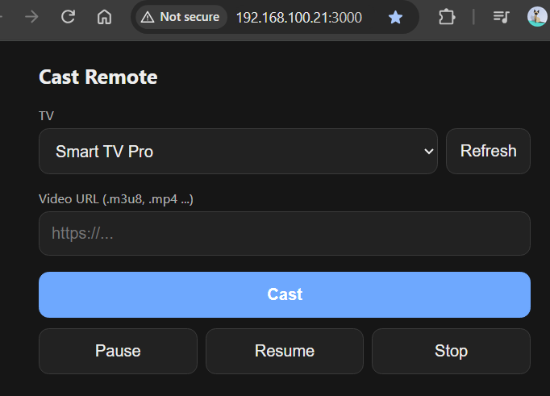

# Install dependency
1. npm i

# Run simple web server
2. node main.js  

# Can just F12 to get the video src url or
3. Optional - Install Chrome Extension at PC to quickly grab the URL 

4. Open `http://<host-ip>:3000` on your mobile or PC. For example: `http://192.168.100.21:3000`.

# Input URL to chromecast your TV
5. input the URL, and cast (ensure TV is ON, and refresh the page if not working)

